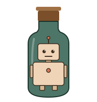

<p align="center">
  
</p>

# bot-bottle

[](https://gitea.dideric.is/didericis/bot-bottle/actions?workflow=test.yml)
[](https://coverage.readthedocs.io/)
[](https://gitea.dideric.is/didericis/bot-bottle/src/branch/main/docs/decisions/0004-coverage-policy.md)

**Problem:** Developer wants to run a coding agent without supervision, but they don't want a prompt injected or misbehaving agent wrecking their environment or exfiltrating sensitive data.

**Solution:** Ephemeral, per agent "bottles" the agent cannot modify that scan all traffic for data exfiltration and limit capabilities and egress to only what the agent needs.

## Features

- **Per-bottle egress allowlist** — TLS-bumped HTTP/HTTPS chokepoint with a per-manifest host allowlist; per-route path/method/header `matches` filtering; outbound DLP scanning for known tokens and secrets, inbound DLP scanning for prompt-injection attempts; DoH and arbitrary hosts blocked by default.
- **Per-route token-match policy** — each egress route picks what happens when the outbound DLP catches a token via `dlp.outbound_on_match`: `supervise` (default) holds the request and surfaces it in `./cli.py supervise` for approval (an approved value is remembered for the life of the proxy); `redact` scrubs the value and forwards; `block` is a hard `403`. Cuts false-positive friction without weakening default-deny.
- **Tokens the agent never sees** — host secrets live in a gateway; the agent dials `http://gateway:9099/<path>` and the proxy strips inbound `Authorization` and injects the real token before forwarding. `printenv` in the agent shows proxy URLs only.
- **Gitleaks-scanned push (git-gate)** — `bottle.git` remotes route through a per-bottle `git daemon` that gitleaks-scans incoming refs pre-receive and forwards clean refs upstream over SSH. The agent never holds the upstream credential.
- **Manifest-scoped skills + secrets** — each bottle declares its skills, env, git identity, remotes, and egress routes; unknown keys die at load.
- **Trust boundary at `$HOME`** — bottles (credentials, egress, remotes) live only under `~/.bot-bottle/bottles/`. Repos may ship agents but not bottles, so a cloned repo can't redirect an env var to an attacker host.
- **Composable bottles (`extends:`)** — keep provider/runtime policy in one base bottle (e.g. `claude.md`) and overlay task bottles on top.
- **Parallel, isolated bottles** — each bottle runs in its own backend-owned isolation boundary; bottles don't share state or talk to each other.
- **Provider templates (Claude, Codex)** — `Dockerfile.claude` / `Dockerfile.codex`, or a bottle-supplied Dockerfile. Claude auth via long-lived OAuth token; Codex via opt-in host device-auth forwarding.
- **gVisor auto-detect** — on Linux hosts where `runsc` is registered with Docker, every bottle launches under it for a userspace syscall barrier; no manifest config required.
- **Apple Container backend (macOS default when available)** — runs the agent and gateway with Apple's `container` CLI, using a host-only agent network plus a separate gateway egress network.
- **Firecracker backend (Linux default when available)** — runs the agent in a KVM Firecracker microVM reached over SSH on a point-to-point TAP, with the gateway in Docker. A dedicated, fail-closed `nftables` table isolates the guest, closing the raw DNS/IP exfiltration gap that exists in the legacy Docker backend. Requires KVM (`/dev/kvm`) and a one-time privileged network-pool setup.
- **Legacy Docker backend** — still available for examples, CI, and hosts without Apple Container or KVM via `BOT_BOTTLE_BACKEND=docker` or `--backend=docker`.

## Architecture

On the default macOS Apple Container backend, a bottle is an agent container on a host-only internal network plus a gateway attached to both that internal network and a NAT egress network. The agent gets HTTP(S)_PROXY and CA bundle env vars pointing at the gateway's internal-network IP, so HTTP/HTTPS traffic flows through the gateway instead of direct egress. `bottle.git` / git-gate is intentionally deferred on this backend until a safe Apple Container key-delivery path exists.

On the Firecracker backend, a bottle is an agent microVM plus a Docker gateway for egress, git-gate, and supervise. The VM reaches the gateway over a per-bottle point-to-point TAP link; a dedicated fail-closed `nftables` table (`inet bot_bottle_fc`) confines the guest to that link, so nothing leaves the box except through the gateway. The TAP pool and nft table are provisioned once (root); per-launch needs no privilege.

On the legacy Docker backend, the same logical bottle is two containers per agent: an `agent` container and a `companion containers` container. They share a per-agent Docker `--internal` network; the agent has no default route off-box.

The Docker topology looks like this:

```
                            host  ( ./cli.py )
                                  │
                          starts  │  stops
                                  ▼
   ┌─────────────────────────── bottle ──────────────────────────────────┐
   │                                                                     │
   │   ┌──────────────────┐                   ┌──────────────────────┐   │
   │   │ agent image      │   HTTP(S) proxy   │ egress image         │   │
   │   │ (claude-code,    │ ─────────────────►│ (mitmproxy; TLS bump │   │  HTTPS to
   │   │  codex, etc)     │                   │  DLP scan, path      │───┼──►  allowlisted
   │   │                  │                   │  matching, auth      │   │     hosts
   │   │ environ: proxy   │                   │  injection)          │   │
   │   │ URLs only, no    │                   └──────────────────────┘   │
   │   │ real tokens      │                                              │
   │   │                  │    git proxy     ┌────────────────┐          │  SSH push/fetch
   │   │                  │ ────────────────►│ git-gate image │──────────┼──►  to bottle.git
   │   │                  │                  │ (gitleaks +    │          │      upstreams
   │   └──────────────────┘                  │  git daemon)   │          │     (direct — not
   │                                         └────────────────┘          │      via egress)
   │                                                                     │
   │   agent on internal network (no default route); egress and          │
   │   git-gate straddle internal + egress networks.                     │
   │   egress is the single HTTP/HTTPS chokepoint — all agent HTTP/HTTPS │
   │   traffic flows through it. git-gate's SSH egress is direct         │
   │   because egress is HTTP-only.                                      │
   └─────────────────────────────────────────────────────────────────────┘
```

When the agent exits, `cli.py` tears down every gateway and both networks; nothing about a bottle persists between runs.

## Quickstart

On compatible macOS hosts, the default backend requires Apple's `container` CLI and does not require Docker. The Firecracker backend (Linux) requires Docker on the host for the gateway plus the `firecracker` binary and KVM. The legacy Docker backend requires Docker. Claude bottles also need a long-lived Claude Code OAuth token (`claude setup-token`) exported as `BOT_BOTTLE_CLAUDE_OAUTH_TOKEN`.

Use `BOT_BOTTLE_BACKEND=docker ./cli.py start <agent>` on hosts where neither Apple Container nor KVM is available and Docker is the desired backend.

### Firecracker on Linux

On Linux, a KVM-capable host defaults to the Firecracker backend. It needs:

- **`/dev/kvm`** present and accessible. Load `kvm-intel` or `kvm-amd` (and enable virtualization in BIOS/firmware). The invoking user must be in the `kvm` group: `sudo usermod -aG kvm "$USER"` then re-login. bot-bottle preflights this and reports exactly what's missing.
- **`firecracker`** on `PATH`: grab a release from <https://github.com/firecracker-microvm/firecracker/releases>. Start flows print this pointer when the binary is missing.
- **Docker** for the gateway and image build.
- **A one-time privileged network setup** — the per-bottle TAP pool plus the fail-closed `nftables` isolation table. Run `./cli.py backend setup --backend=firecracker` for the host-appropriate config (a NixOS module, a `sudo` script elsewhere); `./cli.py backend status --backend=firecracker` reports what's present, including whether the pool range collides with an existing route. The pool defaults to `10.243.0.0/16` (an obscure RFC-1918 block that dodges docker/libvirt/LAN and, deliberately, Tailscale's `100.64.0.0/10` CGNAT range); override with `BOT_BOTTLE_FC_IP_BASE` if it clashes on your host.

```sh
BOT_BOTTLE_BACKEND=firecracker ./cli.py start <agent>
```

> **NixOS:** enable `virtualisation.docker`, ensure the KVM module is loaded (`boot.kernelModules = [ "kvm-intel" ];` or `kvm-amd`), and add your user to the `kvm` and `docker` groups. For the network pool, consume the flake module — `imports = [ inputs.bot-bottle.nixosModules.firecracker-netpool ]; services.bot-bottle-firecracker = { enable = true; owner = "you"; };` — then `nixos-rebuild switch` (imperative nft/TAP rules don't survive a rebuild; channel users can `imports = [ <bot-bottle>/nix/firecracker-netpool.nix ]`). `firecracker` isn't in nixpkgs by default as a user binary — install the release binary (pin the version) and put it on `PATH`.

> **CI:** the coverage gate (`.gitea/workflows/test.yml` → `coverage` job) runs on a self-hosted runner labelled `kvm`, because the Firecracker backend's VM/SSH orchestration is exercised only by the integration suite, which needs `/dev/kvm` + the provisioned pool (a container runner would skip it and read as uncovered). Provision that runner exactly like a normal Firecracker host — `firecracker` on `PATH`, `/dev/kvm`, Docker, the cached guest kernel + static dropbear, and the pool installed as the persistent systemd unit — then register it with the `kvm` label. The unit/lint jobs still run on `ubuntu-latest`.

```sh
./cli.py start <agent>   # builds the image on first run, drops you into claude
```

## Manifest

Bottles and agents are Markdown files with YAML frontmatter under `~/.bot-bottle/`. The Markdown body is the system prompt. Bottles live in `~/.bot-bottle/bottles/`; agents may also be shipped by a repo at `<repo>/.bot-bottle/agents/<name>.md`.

**Bottle** (`~/.bot-bottle/bottles/gitea-dev.md`):

````markdown
---
extends: claude          # inherit the Claude provider boundary

env:
  GIT_AUTHOR_NAME: didericis

git:
  user:
    name: "Eric Bauerfeld"
    email: "eric+claude@dideric.is"
  remotes:
    gitea.dideric.is:
      Name: bot-bottle
      Upstream: ssh://git@gitea.dideric.is:30009/didericis/bot-bottle.git
      IdentityFile: /Users/didericis/.ssh/id_ed25519_gitea
      KnownHostKey: ssh-ed25519 AAAA...

egress:
  routes:
    - host: gitea.dideric.is
      auth:
        scheme: token        # Bearer | token
        token_ref: BOT_BOTTLE_GITEA_TOKEN
      matches:               # optional — restrict to specific paths/methods/headers
        - paths:
            - {type: prefix, value: /api/v1/}
          methods: [GET, POST, PATCH, DELETE]
      dlp:                   # optional — per-route detector overrides (default: all on)
        outbound_detectors: [token_patterns, known_secrets]
        inbound_detectors: false   # disable response scanning for this host
---

The `gitea-dev` bottle. Provider auth via the inherited Claude route;
gitea over SSH for push, token over HTTPS for the API.
````

**Agent** (`~/.bot-bottle/agents/gitea-helper.md`):

````markdown
---
bottle: gitea-dev
skills:
  - init-prd
---

You help maintain Gitea-hosted projects.
````

**Egress route fields:**

| Field | Required | Description |
|---|---|---|
| `host` | yes | Hostname to allowlist. One entry per host. |
| `role` | no | Reserved for future use. The key is recognised but any value is currently rejected at load. Provider auth routes (e.g. Claude's `api.anthropic.com`) are injected automatically from `agent_provider.auth_token`, not via `role`. |
| `auth.scheme` | when `auth` present | `Bearer` or `token`. Injected by the proxy; the agent never sees the value. |
| `auth.token_ref` | when `auth` present | Env-var name holding the secret on the host. |
| `matches` | no | Array of `{paths, methods, headers}` filters. A request must match at least one entry (if any are given) to be forwarded. |
| `matches[].paths` | no | Array of `{type, value}`. `type` is `prefix` (default), `exact`, or `regex`. |
| `matches[].methods` | no | Array of HTTP method strings, e.g. `[GET, POST]`. |
| `matches[].headers` | no | Array of `{name, value, type}`. `type` is `exact` (default) or `regex`. |
| `dlp` | no | Per-route DLP overrides. Omit to use defaults (all detectors on). |
| `dlp.outbound_detectors` | no | `false` disables outbound scanning; list restricts to named detectors (`token_patterns`, `known_secrets`). |
| `dlp.inbound_detectors` | no | `false` disables inbound scanning; list restricts to named detectors (`naive_injection_detection`). |
| `dlp.outbound_on_match` | no | What to do when an outbound token is detected: `supervise` (default for manifest routes — hold for operator approval), `redact` (scrub the value and forward), or `block` (hard 403). Agent-provider routes (e.g. `api.anthropic.com`) default to `redact`. |
| `git.fetch` | no | `true` permits smart HTTP clone/fetch (`git-upload-pack`) for this host. Push (`git-receive-pack`) remains blocked. |

When an outbound DLP detector matches a token, the route's `dlp.outbound_on_match` policy decides what happens. Under the default `supervise`, the proxy queues an `egress-token-allow` proposal for the operator's `./cli.py supervise` TUI and holds the request open until it is answered (or `EGRESS_TOKEN_ALLOW_TIMEOUT_SECONDS`, default 300s, elapses — after which it fails closed). The operator never sees the raw token, only the host, method, path, and a redacted snippet; approving adds the value to an in-memory safelist for the life of the egress proxy. Under `redact`, the matched value is scrubbed from the body, headers, and path and the request is forwarded (failing closed if a match lands somewhere unredactable, like the hostname). Under `block` it stays a hard `403`. Structural blocks (CRLF injection) and not-in-allowlist host blocks are always hard `403`s regardless of policy.

More examples in `examples/`. Full design lives under `docs/prds/`; the trust-boundary rationale is in `docs/prds/0011-per-file-md-manifest.md`.

## Tracker policy

Issues are the canonical work items and own all tracker labels; every issue
must have at least one. Pull requests stay unlabeled and deliberately reference
an issue with `Closes #…`, `Part of #…`, or another form defined in
[`ADR 0005`](docs/decisions/0005-issues-own-tracker-metadata.md). Gitea Actions
enforces the convention for new work from 2026-07-18 onward. Earlier closed
PRs are grandfathered rather than given artificial retrospective issues.

## Trademarks

bot-bottle is an independent project and is not affiliated with, endorsed by, or sponsored by Anthropic, PBC. "Claude" and "Claude Code" are trademarks of Anthropic, PBC; the project name uses "claude" descriptively to indicate that the tool runs Claude Code inside a sandbox.

## License

Copyright 2026 Eric Bauerfeld. Licensed under the Apache License, Version 2.0. See [LICENSE](LICENSE) for the full text.
