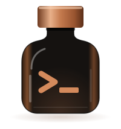

<p align="center">
  
</p>

# bot-bottle

**Problem:** Developer wants to run a coding agent without supervision, but they don't want a prompt injected or misbehaving agent wrecking their environment or exfiltrating sensitive data.

**Solution:** Ephemeral, per agent "bottles" the agent cannot modify that scan all traffic for data exfiltration and limit capabilities and egress to only what the agent needs.

## Features

- **Per-bottle egress allowlist** — TLS-bumped HTTP/HTTPS chokepoint with a per-manifest host allowlist; per-route path/method/header `matches` filtering; outbound DLP scanning for known tokens and secrets, inbound DLP scanning for prompt-injection attempts; DoH and arbitrary hosts blocked by default.
- **Per-route token-match policy** — each egress route picks what happens when the outbound DLP catches a token via `inspect.outbound_on_match`: `supervise` (default) holds the request and surfaces it in `bot-bottle supervise` for approval (an approved value is remembered for the life of the proxy); `redact` scrubs the value and forwards; `block` is a hard `403`. Cuts false-positive friction without weakening default-deny.
- **Tokens the agent never sees** — host secrets live in a gateway; the agent dials `http://gateway:9099/<path>` and the proxy strips inbound `Authorization` and injects the real token before forwarding. `printenv` in the agent shows proxy URLs only.
- **Gitleaks-scanned push (git-gate)** — `bottle.git` remotes route through the gateway's git-gate, which gitleaks-scans incoming refs pre-receive, refuses any push carrying a secret the bottle holds (its `?` secret env values and its exfil canary, matched by value rather than by shape), and forwards clean refs upstream over SSH. The agent never holds the upstream credential.
- **Manifest-scoped secrets and skills** — each bottle declares its env, git identity, remotes and egress routes, and each agent its skills and harness; unknown keys die at load.
- **Project bottles need your trust** — your bottles (credentials, egress, remotes) live in `~/.bot-bottle/bottles/`. A repo may also ship bottles in `./.bot-bottle/bottles/`, named `./<name>` (its default is `./main`), but they run only after you've trusted their exact contents on this host (`bot-bottle trust ./<name>`), and any change asks again. The trust prompt lists every host and secret the bottle touches (including what it inherits through `extends`), and a project bottle never shares a name with yours, so a cloned repo can't send a credential to another host without you seeing it first.
- **Composable bottles (`extends:`)** — keep shared policy in one base bottle and overlay task bottles on top; the agent picks its own harness (`agent_provider`), so one bottle serves Claude, Codex and pi agents alike.
- **Parallel, isolated bottles** — each bottle runs in its own backend-owned isolation boundary; bottles don't share state. They share the per-host gateway, which attributes every request to its bottle by source IP and keeps each bottle's policy, tokens and git-gate repos separate.
- **Provider harnesses (Claude, Codex, pi)** — `bot_bottle/contrib/{claude,codex,pi}/Dockerfile`, or an agent-supplied Dockerfile. Claude auth via long-lived OAuth token; Codex via opt-in host device-auth forwarding.
- **gVisor auto-detect** — on Linux hosts where `runsc` is registered with Docker, every bottle launches under it for a userspace syscall barrier; no manifest config required.
- **Apple Container backend (macOS default when available)** — runs the agent and gateway with Apple's `container` CLI, using a host-only agent network plus a separate gateway egress network. A host pf anchor, installed once with `sudo`, keeps agents off the Mac itself, which a host-only network alone doesn't.
- **Firecracker backend (Linux default when available)** — runs the agent in a KVM Firecracker microVM reached over SSH on a point-to-point TAP; the orchestrator and gateway run in their own per-host microVMs, so the host needs no Docker. A dedicated, fail-closed `nftables` table isolates the guest. Requires KVM (`/dev/kvm`) and a one-time privileged network-pool setup.
- **Docker backend (fallback)** — for CI and hosts without Apple Container or KVM, via `BOT_BOTTLE_BACKEND=docker` or `--backend=docker`. It is the weakest boundary: agents are containers sharing the host kernel (gVisor narrows that when installed). Their network is `--internal`, so the gateway is still the only way out.
- **Launch-time isolation probe** — before an agent runs, bot-bottle proves from inside it that it cannot reach the host or a public address without the gateway (and, on Docker and macos-container, cannot resolve public names), and refuses to start it otherwise. Every backend runs it.

## Architecture

Every backend has the same shape. Each host runs one **orchestrator** (the
control plane) and one **gateway** (the data plane), started on demand and
shared by every bottle on that host. Each bottle is just the agent, in its own
container or microVM, pointed at the gateway for all outbound traffic.

- The **gateway** runs the egress proxy (mitmproxy: TLS bumping, route
  allowlist, DLP, token injection), git-gate (a smart-HTTP git server that
  gitleaks-scans pushes and forwards clean refs upstream over SSH) and the
  supervise endpoint. It attributes each request to a bottle by the agent's
  source IP, which the backend pins and the agent cannot change, so one gateway
  enforces each bottle's own policy.
- The **orchestrator** holds the bottle registry, the signing key and the
  approval queue. Agents have no route to it; the gateway and the host CLI do.
- The **host controller** runs on the host as your user. The CLI and the
  orchestrator use it to launch, list, attach to and tear down bottles. Each
  agent session runs in tmux, so it survives the terminal that started it and
  can have several viewers.

```
  host CLI ──► host controller ──► backend (launch / teardown)
                                       │
  ┌──────────── per host ──────────────┼──────────────────────────────────┐
  │                                    ▼                                  │
  │  ┌───────────────┐       ┌─────────────────────────┐                  │
  │  │ agent         │ HTTPS │ gateway                 │ HTTPS to         │
  │  │ (claude,      │──────►│  egress proxy (DLP,     │──► allowlisted   │
  │  │  codex, pi)   │       │   token injection)      │    hosts         │
  │  │               │  git  │  git-gate (gitleaks)    │ SSH push to      │
  │  │ env: proxy    │──────►│  supervise              │──► upstreams     │
  │  │ URLs only,    │       └────────────┬────────────┘                  │
  │  │ no real       │                    │ control network               │
  │  │ tokens        │       ┌────────────▼────────────┐                  │
  │  └───────────────┘       │ orchestrator            │                  │
  │   one per bottle;        │  registry, signing key, │                  │
  │   no route to the        │  approval queue         │                  │
  │   control plane          └─────────────────────────┘                  │
  └───────────────────────────────────────────────────────────────────────┘
```

How each backend builds that boundary:

| Backend | Agent | Orchestrator and gateway | What confines the agent |
|---|---|---|---|
| **macos-container** (macOS default) | Apple container | Two Apple containers | Host-only agent network plus a host pf anchor that drops agent traffic to the Mac and anything off the network; only the gateway is also on the NAT egress and control networks |
| **firecracker** (Linux default with KVM) | Firecracker microVM, reached over SSH | Two Firecracker microVMs | Point-to-point TAP per bottle plus a fail-closed `nftables` table (`inet bot_bottle_fc`); the gateway's ports are DNAT'd to the gateway VM, and nothing else leaves the box |
| **docker** (fallback) | Docker container (gVisor `runsc` when registered) | Two Docker containers | `--internal` agent network with no route off the box; only the gateway is also on the egress and control networks |

When the agent exits, its bottle is deregistered from the orchestrator, its
git-gate deploy keys are revoked, and its container or VM is removed. The
orchestrator and gateway keep running for the next bottle.

The full picture is in [`docs/reference/architecture.md`](docs/reference/architecture.md).

## Roadmap

Planned or in progress, not shipped yet:

- **Audit producers** ([#468](https://gitea.dideric.is/didericis/bot-bottle/issues/468)): the host-side audit journal, its OCSF export and the request firehose exist, but the orchestrator and gateway don't write audit events to the journal yet.
- **Remote access from the web console** ([#478](https://gitea.dideric.is/didericis/bot-bottle/issues/478)): `bot-bottle pair`, console launches and terminals, and the host side of supervise approvals work; the console's approvals UI and escape-sequence filtering for remote viewers don't yet.
- **Egress metering and budgets** ([#251](https://gitea.dideric.is/didericis/bot-bottle/issues/251)): per-bottle cost tracking with a forced cutoff.
- **Minted, refreshing credentials** ([#355](https://gitea.dideric.is/didericis/bot-bottle/issues/355)) and **AWS SigV4 re-signing** ([#662](https://gitea.dideric.is/didericis/bot-bottle/issues/662)).
- **Signed, attested images** ([#339](https://gitea.dideric.is/didericis/bot-bottle/issues/339)) and a **published threat model** ([#337](https://gitea.dideric.is/didericis/bot-bottle/issues/337)).

## Quickstart

```sh
curl -fsSL "https://gitea.dideric.is/api/v1/repos/didericis/bot-bottle/raw/install.sh?ref=main" | sh
```

The installer is a bootstrapper: it finds a suitable Python, installs bot-bottle with its `remote` extra for phone pairing (none on Intel Macs, which iroh has no build for) using `uv` or `pipx` if you have either, or a private venv at `~/.bot-bottle/venv`, creates `~/.bot-bottle`, and runs `bot-bottle setup` and `bot-bottle doctor`. It is idempotent and never uses `sudo`. Python-native users can skip it entirely: `uv tool install "bot-bottle[remote] @ git+https://gitea.dideric.is/didericis/bot-bottle.git"` (or the same with `pipx install`).

### Uninstall

```sh
bot-bottle uninstall            # everything bot-bottle set up; keeps ~/.bot-bottle
bot-bottle uninstall --purge    # also your agents, bottles, secrets, audit journal and frozen bottles
```

It shows what it will remove and asks first. It stops the host controller and each backend's orchestrator and gateway, and removes autostart. It removes each backend's containers, networks, volumes and images, and undoes each backend's privileged setup (on macOS that prints the `sudo` lines for the pf firewall; `--keep-backend` skips this). Then it removes `~/.cache/bot-bottle` and the package itself (the installer's venv and shim, or `pipx`/`uv tool uninstall`). Base images it pulled to build on, such as `python` or `node`, stay. If `bot-bottle` itself won't run, `curl -fsSL "<the install URL>" | sh -s -- --uninstall` removes the installer's venv and shim and says what's left.

### Requirements

**Python ≥ 3.11**, or nothing: with no suitable Python the installer has uv supply Python 3.13 (your uv if you have one, else a pinned uv release it downloads, checks against its published SHA-256 and keeps privately under `~/.bot-bottle/uv` with that Python and bot-bottle itself, where `bot-bottle uninstall` removes them). When you do have Python, this is what trips people up on macOS: the `python3` Apple ships at `/usr/bin/python3` is **3.9.6**, which is too old. Bare `python3` resolves to that stub far more often than people expect. `path_helper` builds a login shell's `PATH` from `/etc/paths` and then appends `/etc/paths.d/*`, and `/usr/bin` sits in the former — so even when `/opt/homebrew/bin` *is* on the `PATH` (via `/etc/paths.d/homebrew`), it comes after `/usr/bin` and loses. Prepending a newer Python is something your shell profile does, and a fresh account, a launchd job, or a CI runner has no such profile. So the installer looks past bare `python3` before giving up: it tries `python3`, then the versioned `python3.11`–`python3.14` names, then `/opt/homebrew/bin`, `/usr/local/bin`, `~/.local/bin`, and python.org framework builds — and tells you which one it picked when it isn't the obvious one. Point it somewhere specific with `BOT_BOTTLE_PYTHON=/path/to/python3`.

**No `uv` or `pipx` required.** If either is present the installer uses it (`uv` first) and stays out of the way. If neither is, bot-bottle installs into a private venv at `~/.bot-bottle/venv` (override with `BOT_BOTTLE_VENV`) and symlinks the entry point into `~/.local/bin`. There is deliberately no `pip install --user` path: Homebrew, python.org and Debian/Ubuntu interpreters are all externally managed (PEP 668), which blocks `--user` outright — so on a Mac it is never the fallback it appears to be. A venv is exempt from PEP 668, and `venv` is stdlib, so unlike `uv` or `pipx` there is nothing to bootstrap first.

**`git`**, because the default install spec is a `git+` URL. Set `BOT_BOTTLE_INSTALL_SPEC` to a wheel path or index name to avoid it.

**A backend**, which the installer deliberately does *not* install for you — `doctor` reports what's missing afterwards. On compatible macOS hosts, the default backend requires Apple's `container` CLI and does not require Docker, plus a one-time privileged step: `bot-bottle install --backend=macos-container` prints the `sudo` commands that install the host firewall (a pf anchor and a LaunchDaemon that reloads it at boot). Without it, launches are refused. The Firecracker backend (Linux) requires the `firecracker` binary, KVM and e2fsprogs; Docker is needed only to build the infra images from source instead of using a release. The Docker backend requires Docker. Every backend needs tmux 3.1 or newer, which runs the agent sessions. A Claude agent signs in either with your host's Claude Code login (`agent_provider.forward_host_credentials: true`, what `bot-bottle setup` writes when Claude Code is installed and logged in) or with a long-lived token from `claude setup-token`, kept in a host variable that `agent_provider.auth_token` names. Either way the gateway injects it; the agent only ever sees a placeholder.

Use `BOT_BOTTLE_BACKEND=docker bot-bottle start <agent>` on hosts where neither Apple Container nor KVM is available and Docker is the desired backend.

> **CI (macOS Apple Container):** the advisory `integration-macos` job in `.gitea/workflows/pre-release-test.yml` runs only on manual dispatch. It targets a self-hosted host-mode runner labelled `macos`; Apple Container cannot run inside the Linux pull-request runner. Provision an Apple Silicon host with the `container` CLI running and Python ≥ 3.11 plus `coverage` on the launchd service's explicit `PATH`. The infra container is a singleton (`bot-bottle-mac-infra`), so keep runner concurrency at 1. Install the host firewall on that host once (`sudo bot-bottle install --backend=macos-container`, or the printed `sudo` block); the runner itself never gets root, and the job's preflight and isolation probe fail without it. Its coverage is reported separately and never feeds the required pull-request gate.

### Keeping a bottled agent's guest

A stopped bottled agent keeps its home (its conversation and workspace) and
resumes into a new guest. A bottle may set `preserve_container: true` to keep
the guest itself too, for an agent whose image gives it root, so what it
installs stays across stop and resume. `bot-bottle resume --fresh <bottled
agent>` starts a new guest from the agent's current image instead, its home
kept. See [backends](docs/reference/backends.md#keeping-the-guest).

### Containers inside a bottle

A bottle may set `nested_containers: true`. On the macOS backend this starts a
guest-local, rootless **podman** service after the bottle is registered and
exposes its Docker-compatible API socket, so the agent still runs `docker` and
`docker compose`. Nothing is mounted from the host: Docker Desktop's socket
stays out of the bottle and the guest gains no outer VM capabilities. Backends
that cannot do this (`docker`, `firecracker`) reject the flag rather than
silently ignore it.

Rootless Docker was tried first and does not work here at all: Apple
Container's capability bounding set omits `CAP_SYS_ADMIN`, which the kernel
requires to write a multi-range `uid_map`.

The tradeoff to understand before enabling it: podman avoids that requirement
by falling back to a single-UID mapping, so nested containers provide **no
isolation from the agent itself** — `root` inside a nested container is the
agent user outside it. Nested containers are a build/test convenience, not a
security boundary. The bottle remains the boundary.

Pulling images goes through the bottle's egress proxy like every other
request, so each registry needs a route — **and so does the CDN it redirects
layer blobs to**, which is a different host. Without the CDN route the pull
authenticates, fetches the manifest, then 403s partway through.

Docker Hub and GHCR additionally need `inspect.preserve_auth: true`: their token dance
uses a client-fetched per-scope bearer token that the proxy would otherwise
strip. Turn DLP off on every registry and CDN route — the bodies are
compressed layer blobs that no detector can read, and buffering them is what
triggers the shared-proxy OOM in #455.

```yaml
nested_containers: true
egress:
  routes:
    # Docker Hub: registry, token endpoint, blob CDN.
    - host: registry-1.docker.io
      inspect: { preserve_auth: true, outbound_detectors: false, inbound_detectors: false }
    - host: auth.docker.io
      inspect: { preserve_auth: true, outbound_detectors: false, inbound_detectors: false }
    - host: production.cloudfront.docker.com
      inspect: { outbound_detectors: false, inbound_detectors: false }
    # GHCR: registry + blob CDN.
    - host: ghcr.io
      inspect: { preserve_auth: true, outbound_detectors: false, inbound_detectors: false }
    - host: pkg-containers.githubusercontent.com
      inspect: { outbound_detectors: false, inbound_detectors: false }
    # quay.io: registry + blob CDNs. No preserve_auth needed for public pulls.
    - host: quay.io
      inspect: { outbound_detectors: false, inbound_detectors: false }
    - host: cdn01.quay.io
      inspect: { outbound_detectors: false, inbound_detectors: false }
    - host: cdn02.quay.io
      inspect: { outbound_detectors: false, inbound_detectors: false }
    - host: cdn03.quay.io
      inspect: { outbound_detectors: false, inbound_detectors: false }
```

`mcr.microsoft.com` and `registry.k8s.io` follow the same shape and also
redirect blobs elsewhere (`*.data.mcr.microsoft.com` and
`us-*-docker.pkg.dev` respectively); route whichever host the 403 names.

Inside a nested container the same allowlist applies: an allowlisted host
returns 200 and anything else gets a 403 straight from the proxy. The
gateway's CA bundle and proxy settings are wired in automatically, so
`docker run … curl https://…` works with no extra flags — no `--add-host`,
`-e`, or `-v`.

Two things worth knowing when testing that:

- Public DNS inside a nested container fails **by design**. Everything
  egresses through the proxy, so `nslookup` failing is expected and is not
  evidence of a problem.
- Alpine's BusyBox `wget` drops the connection after the proxy's TLS
  interception and reports `error getting response`, even though the proxy
  logs the decrypted request and returns a response. Use `curl` to test
  egress; BusyBox `wget` will lie to you.

### Firecracker on Linux

On Linux, a KVM-capable host defaults to the Firecracker backend. It needs:

- **`/dev/kvm`** present and accessible. Load `kvm-intel` or `kvm-amd` (and enable virtualization in BIOS/firmware). The invoking user must be in the `kvm` group: `sudo usermod -aG kvm "$USER"` then re-login. bot-bottle preflights this and reports exactly what's missing.
- **`firecracker`** on `PATH`: grab a release from <https://github.com/firecracker-microvm/firecracker/releases>. Start flows print this pointer when the binary is missing.
- **e2fsprogs** (`mke2fs`, `debugfs`, `e2fsck`, `resize2fs`) for building root filesystems. Docker is optional: it is used only to build the infra images from source rather than downloading a release's prebuilt ones.
- **A one-time privileged network setup** — the per-bottle TAP pool plus the fail-closed `nftables` isolation table. Run `bot-bottle install --backend=firecracker` for the host-appropriate config (a NixOS module, a `sudo` script elsewhere) plus autostart for the host controller; `bot-bottle doctor --backend=firecracker` reports what's present, including whether the pool range collides with an existing route. The pool defaults to `10.243.0.0/16` (an obscure RFC-1918 block that dodges docker/libvirt/LAN and, deliberately, Tailscale's `100.64.0.0/10` CGNAT range); override with `BOT_BOTTLE_FC_IP_BASE` if it clashes on your host.

```sh
BOT_BOTTLE_BACKEND=firecracker bot-bottle start <agent>
```

> **NixOS:** ensure the KVM module is loaded (`boot.kernelModules = [ "kvm-intel" ];` or `kvm-amd`) and add your user to the `kvm` group. Docker (`virtualisation.docker`, plus the `docker` group) is only needed to build the infra images from source. For the network pool, consume the flake module — `imports = [ inputs.bot-bottle.nixosModules.firecracker-netpool ]; services.bot-bottle-firecracker = { enable = true; owner = "you"; };` — then `nixos-rebuild switch` (imperative nft/TAP rules don't survive a rebuild; channel users can `imports = [ <bot-bottle>/nix/firecracker-netpool.nix ]`). `firecracker` isn't in nixpkgs by default as a user binary — install the release binary (pin the version) and put it on `PATH`.

> **CI:** Firecracker integration runs in the manually dispatched `.gitea/workflows/pre-release-test.yml` on a self-hosted runner labelled `kvm`; privileged KVM hosts never execute unreviewed PR code automatically. Provision it like a normal Firecracker host: `firecracker` on `PATH`, `/dev/kvm`, the cached guest kernel and static dropbear, and the persistent TAP/nft pool. The required pull-request workflow runs unit plus the complete Docker integration suite on `ubuntu-latest`; see `docs/reference/ci.md`.

```sh
bot-bottle start <agent>   # pulls (or builds) the images on first run, then drops you into the agent
```

## Manifest

Bottles and agents are Markdown files with YAML frontmatter under `~/.bot-bottle/`. An agent's Markdown body is its system prompt; a bottle's is documentation. Bottles live in `~/.bot-bottle/bottles/`; agents may also be shipped by a repo at `<repo>/.bot-bottle/agents/<name>.md`. A repo agent whose `agent_provider` grants something (your login, a model host with a secret, or an image build), or that runs on one of your bottles granting more than `basic`, runs only once this host trusts it, like a repo bottle (`bot-bottle trust <name>`). A repo agent with the same name as one of yours replaces it, and the trust prompt says so.

To let bottles push to a Gitea forge, run `bot-bottle forge connect <url>`: it checks a token, pins the forge's host key and writes a `gitea` bottle. A bottle that extends it grants repos in a line, `git-gate: {repos: [gitea.example.com/acme/app:write]}`, each read-only unless `:write`, with its own deploy key per run (see [git-gate.md](docs/reference/git-gate.md)).

Every change to a bottle or agent under `~/.bot-bottle/` is a version, hand edits included. `bot-bottle bottles history <name>` lists them (add a version to see what it changed) and `bot-bottle bottles revert <name> <version>` restores one as a new version, taking effect at the next launch. A repo's bottles are versioned by the repo itself.

**Bottle** (`~/.bot-bottle/bottles/gitea-dev.md`):

````markdown
---
extends: basic           # start from the built-in package-registry routes

env:
  GIT_AUTHOR_NAME: didericis

git-gate:
  user:
    name: "Eric Bauerfeld"
    email: "eric+claude@dideric.is"
  repos:
    bot-bottle:
      url: ssh://git@gitea.dideric.is:30009/didericis/bot-bottle.git
      key:
        provider: static
        path: /Users/didericis/.ssh/id_ed25519_gitea
      host_key: ssh-ed25519 AAAA...

egress:
  routes:
    - host: gitea.dideric.is
      inspect:
        auth:
          scheme: token        # Bearer | token
          token_ref: BOT_BOTTLE_GITEA_TOKEN
        matches:               # optional — restrict to specific paths/methods/headers
          - paths:
              - type: prefix
                value: /api/v1/
            methods: [GET, POST, PATCH, DELETE]
        outbound_detectors: [token_patterns, known_secrets]
        inbound_detectors: false   # disable response scanning for this host
---

The `gitea-dev` bottle: gitea over SSH for push, token over HTTPS for
the API. The agent's provider adds its own model route.
````

**Agent** (`~/.bot-bottle/agents/gitea-helper.md`):

````markdown
---
bottle: gitea-dev
agent_provider:          # the harness and its login; default is `claude`
  harness: claude
  forward_host_credentials: true
skills:
  - init-prd
---

You help maintain Gitea-hosted projects.
````

**Egress route fields:** a route has `host`, an optional `role`, and an optional `inspect` block holding everything else.

| Field | Required | Description |
|---|---|---|
| `host` | yes | Hostname to allowlist. One entry per host. |
| `role` | no | Reserved for future use. The key is recognised but any value is currently rejected at load. Provider auth routes (e.g. Claude's `api.anthropic.com`) are injected automatically from the agent's `agent_provider`, not via `role`; a bottle route for such a host fails the launch. |
| `inspect.auth.scheme` | when `auth` present | `Bearer` or `token`. Injected by the proxy; the agent never sees the value. |
| `inspect.auth.token_ref` | when `auth` present | Env-var name holding the secret on the host. |
| `inspect.matches` | no | Array of `{paths, methods, headers}` filters. A request must match at least one entry (if any are given) to be forwarded. |
| `inspect.matches[].paths` | no | Array of `{type, value}`. `type` is `prefix` (default), `exact`, or `regex`. |
| `inspect.matches[].methods` | no | Array of HTTP method strings, e.g. `[GET, POST]`. |
| `inspect.matches[].headers` | no | Array of `{name, value, type}`. `type` is `exact` (default) or `regex`. |
| `inspect.outbound_detectors` | no | `false` disables outbound scanning; a list restricts it to named detectors (`token_patterns`, `known_secrets`). Omit for all. |
| `inspect.inbound_detectors` | no | `false` disables inbound scanning; a list restricts it to named detectors (`naive_injection_detection`). Omit for all. |
| `inspect.outbound_on_match` | no | What to do when an outbound token is detected: `supervise` (default for manifest routes — hold for operator approval), `redact` (scrub the value and forward), or `block` (hard 403). Agent-provider routes (e.g. `api.anthropic.com`) default to `redact`. |
| `inspect.preserve_auth` | no | `true` forwards the client's own `Authorization` header instead of stripping it (registries whose token dance fetches per-scope tokens). |
| `inspect.git.fetch` | no | `true` permits smart HTTP clone/fetch (`git-upload-pack`) for this host. Push (`git-receive-pack`) remains blocked. |

When an outbound DLP detector matches a token, the route's `inspect.outbound_on_match` policy decides what happens. Under the default `supervise`, the proxy queues an `egress-token-allow` proposal for the operator's `bot-bottle supervise` TUI and holds the request open until it is answered (or `EGRESS_TOKEN_ALLOW_TIMEOUT_SECONDS`, default 300s, elapses — after which it fails closed). The operator never sees the raw token, only the host, method, path, and a redacted snippet; approving adds the value to an in-memory safelist for that bottle and that host, for the life of the egress proxy (the same value sent to another host is flagged again). Under `redact`, the matched value is scrubbed from the body, headers, and path and the request is forwarded (failing closed if a match lands somewhere unredactable, like the hostname). Under `block` it stays a hard `403`. Structural blocks (CRLF injection) and not-in-allowlist host blocks are always hard `403`s regardless of policy.

More examples in `examples/`. How the system works today is in [`docs/reference/`](docs/reference/architecture.md), and why it is this way is in [`docs/decisions/`](docs/decisions/README.md).

## Tracker policy

Issues are the canonical work items and own all tracker labels; every issue
must have at least one. Pull requests stay unlabeled and deliberately reference
an issue with `Closes #…`, `Part of #…`, or another form defined in
[`ADR 0005`](docs/decisions/0005-issues-own-tracker-metadata.md). Gitea Actions
enforces the convention for new work from 2026-07-18 onward. Earlier closed
PRs are grandfathered rather than given artificial retrospective issues.

## Trademarks

bot-bottle is independent and not affiliated with or endorsed by Anthropic, OpenAI, or the other projects whose agents it runs. Claude, Claude Code and Codex are their owners' trademarks, named here only to say what bot-bottle works with.

## License

Copyright 2026 Eric Bauerfeld. Licensed under the Apache License, Version 2.0. See [LICENSE](LICENSE) for the full text.
